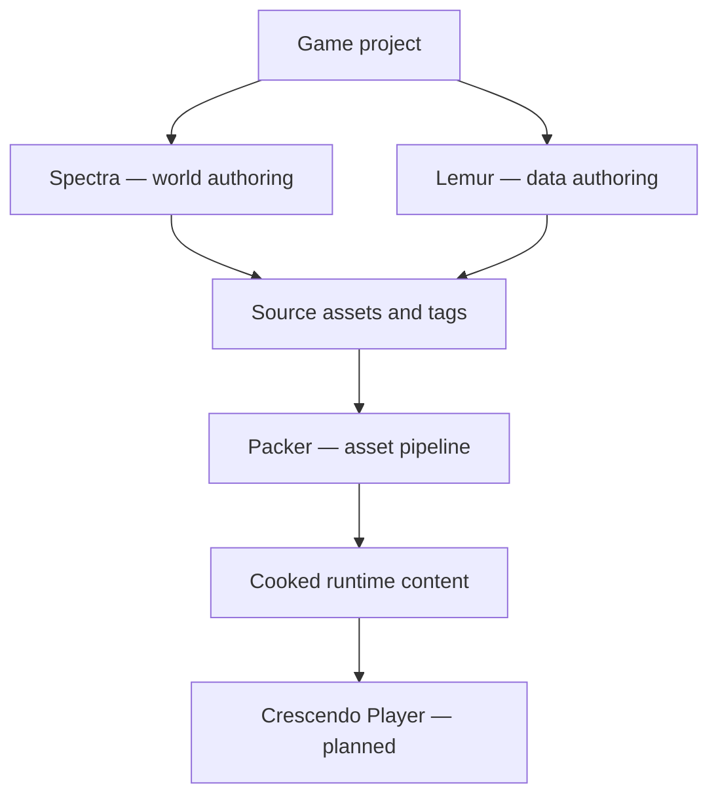

# Crescendo Engine v.0.9

**A modular C++ game engine and SDK by Black Osprey Digital.**

> Build worlds. Experiment with systems. Make every byte count.

Crescendo is an independently developed, data-driven game engine built around the idea that creators should have control over the technology behind their games. Inspired by the modular development and content-authoring philosophies of Blam and Source, Crescendo brings together real-time rendering, physics, gameplay experimentation and an expanding suite of development tools.

The aim is not to build an engine restricted to a single genre. It is to establish a flexible foundation where different gameplay systems can coexist, evolve independently and be assembled into the experience a developer wants to create.

## Procedural Voxel Module

Voxels are currently in another test build that is not public. Those features will move into this repository once operational.

## RTS gameplay loop

The RTS controller is still under active development and is not fully implemented. It uses the same paid production and construction rules for both teams; economy income advances once per simulated second, and factories and engineers complete work over time instead of creating AI assets immediately.

Crescendo is currently in active development, with a focus on **architecture stabilization, runtime efficiency and developer accessibility**.

## From modding to engine development

My journey began in 2007 with game environments and modding. Working with games such as Counter-Strike: Source, Half-Life and Halo sparked an interest in the relationship between the art we create, the systems that drive it and the tools that make it possible.

Over time, that interest developed into 3D modelling, animation, procedural art, programming and eventually the desire to build my own engine. Crescendo is the result of bringing those disciplines together: an ongoing exploration of what an independent developer can create with accessible hardware, open technologies and a willingness to experiment.

## Gameplay development

Crescendo is being developed through practical gameplay prototypes rather than isolated technology demonstrations alone. Each prototype helps reveal weaknesses in the engine and provides a real-world workload for improving its architecture.

| Gameplay system | Development status |
| --- | --- |
| First-person controller | Implemented; experimentation with momentum-based movement and Source-inspired surf mechanics. |
| Ground vehicles | Prototype tested with Jolt Physics. |
| Aircraft | Flight and vehicle physics experiments tested with Jolt Physics. |
| Real-time strategy | Active prototype development, including unit control, AI planning and construction systems. |
| Top-down gameplay | Planned. |
| Roguelike gameplay | Planned. |

The long-term goal is to make these gameplay frameworks optional modules rather than hard-coded requirements of the engine. The RTS project currently serves as a primary testbed for this direction, bringing simulation, input, asset loading and rendering together under real gameplay conditions.

## Engine technology

| Area | Technology and direction |
| --- | --- |
| Core | C++17, modular engine subsystems and component-based scenes. |
| Rendering | Native Vulkan deferred rendering; renderer abstraction intended to support additional graphics APIs. |
| Web | Experimental WebGPU/Emscripten backend under development. |
| Physics | Jolt Physics integration for simulation and gameplay prototypes. |
| Audio | miniaudio-based audio system, spatial sound and procedural sound synthesis experiments. |
| Scripting | Lua integration under development. |
| Networking | Early ENet integration and networked entity experiments. |
| Assets | glTF/GLB loading, JSON data definitions, virtual file system and a custom PAK archive format. |
| Build system | CMake-based native development workflow. |

These systems are at different stages of maturity. Experimental integrations should not be interpreted as production-ready or as feature parity across platforms.

## The Crescendo SDK

Crescendo is growing beyond the runtime into an ecosystem of tools for programmers, artists and game developers.

| Tool | Purpose | Status |
| --- | --- | --- |
| **CrescendoCore** | Shared engine library and subsystem foundation. | Active development |
| **Spectra** | Scene editing, world development and gameplay testing. | Active development |
| **Lemur** | Structured entity and tag data authoring. | Prototype |
| **Crescendo Packer** | Compile project content into runtime archives. | Prototype; overhaul planned |
| **Crescendo Player** | Lightweight standalone game runtime, without editor dependencies. | Planned |
| **Crescendo Engine Lab** | Local-first development dashboard, visual task boards, research journals and project planning. | Working companion tool |

The vision for this toolchain is a project-first workflow: author content, define its behaviour, compile the required assets and launch the game without having to carry the entire editor into a shipping build.

*Target SDK workflow; standalone Player and the full asset cooking pipeline are roadmap objectives.*

## Architecture and development philosophy

- **Modular by design:** Gameplay, rendering, physics, audio and tooling should have clearly defined responsibilities.
- **Data-driven:** Asset definitions and project data should determine how resources are used, rather than requiring constant changes to engine code.
- **Artist-friendly:** Tools should make the transition from creative software to a playable experience as straightforward as possible.
- **Hardware-conscious:** Performance improvements should be measured on accessible consumer hardware, not assumed from flagship GPU specifications.
- **Cross-platform:** Renderer-independent and platform-independent contracts should allow the engine to grow without tying every subsystem to one graphics API.
- **Local-first:** Development tools should remain useful without requiring proprietary cloud services or recurring subscriptions.

## Graphics roadmap

| Backend | Status |
| --- | --- |
| Vulkan | Current native rendering backend |
| WebGPU / WebAssembly | Experimental web development path |
| Direct3D 12 | Planned |
| Metal | Planned |

Additional rendering backends will follow the stabilization of existing renderer contracts. The goal is to preserve the same engine-facing interfaces while allowing each backend to manage its own graphics resources, synchronization and execution model.

## Research and experimentation

Crescendo is also a research environment for exploring more efficient ways to represent, store and render game content.

Areas of interest include:

- **Asset compression and runtime packaging:** content-aware codecs, compact asset representations and independently streamable archive data.
- **Spatial asset loading:** partitioning worlds into regions and maintaining only the resources required for the current view and simulation.
- **GPU-driven rendering:** instancing, visibility culling, level-of-detail selection and reduced CPU submission overhead.
- **Computational art:** procedural geometry, materials and sound generated from mathematical descriptions rather than relying exclusively on baked assets.
- **Neural asset representations:** experimental learned compression and reconstruction techniques, measured against conventional approaches.
- **Hybrid rendering:** research into Gaussian splatting, adaptive spatial detail and temporal or neural reconstruction alongside traditional geometry.

These are research directions, not claims of completed features. Experiments should earn their place through measurable improvements in quality, loading time, memory footprint or rendering performance, with conventional alternatives preserved where appropriate.

> Store the recipe, not necessarily the result.

## Current development priorities

The immediate milestone is to strengthen the foundation before introducing additional complexity:

1. Establish automated regression testing and clear subsystem contracts.
2. Resolve scene authority, entity ownership and resource lifecycle concerns.
3. Separate editor functionality from the shipping runtime.
4. Formalize asset definitions, dependency tracking and the Packer/VFS contract.
5. Build Crescendo Player and distribute the RTS prototype for playtesting.
6. Establish repeatable benchmarks for rendering, loading and memory usage.

Development is organized around a stable `main` branch and a separate experimental workflow, with research and major changes validated before integration.

## Building and documentation

Build and dependency setup instructions are maintained in the repository's separate build instructions file.

For an evidence-based overview of the present architecture, its strengths, limitations and migration priorities, see [the architecture audit](docs/ARCHITECTURE_AUDIT.md). Contributor and coding-agent guidance is maintained in [AGENTS.md](AGENTS.md).

## Why Crescendo?

Game development is more than drawing triangles or writing gameplay code. It is the intersection of art, mathematics, engineering and imagination. Crescendo exists to explore those relationships and to make the resulting technology approachable for people who want to build something of their own.

This is an evolving project, not a finished commercial engine. The intention is to build a foundation that grows through experimentation, practical games, transparent development and feedback from other creators.

**Less friction. Less bloat. More creative freedom.**

---

Developed by **Bryan Burnett / [Black Osprey Digital](https://github.com/BlackOspreyDigital)**.

## Community

Future updates are available in the [Black Osprey Digital Discord](https://discord.gg/Qad36zEp4K). Developers interested in the project can also get in touch there. We are not actively recruiting, but collaboration enquiries are welcome.
