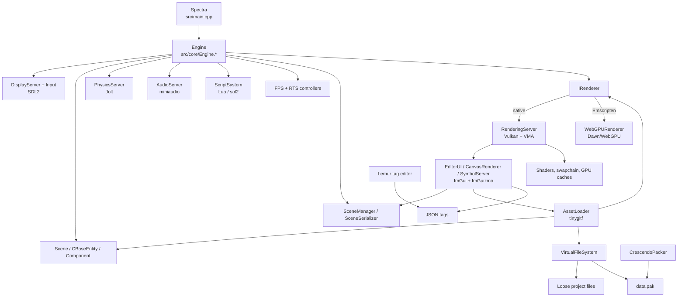
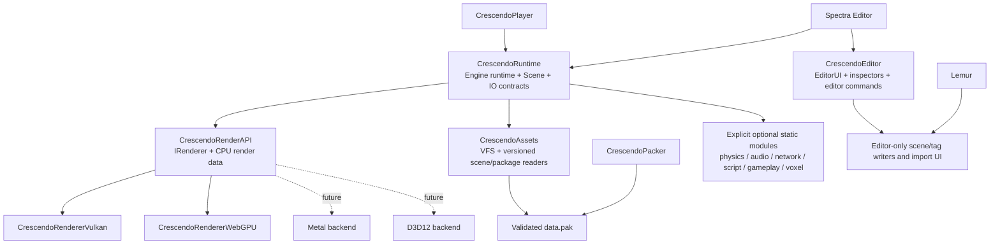

# Crescendo Architecture Audit (ARCH-001)

## Scope and evidence

This audit describes the repository at `main` commit `ff79c89` on 2026-11-20. It is a source and build-graph audit; no engine implementation was changed.

Status terms used below:

- **Implemented**: compiled or directly exercised by the current native targets.
- **Partial**: code exists, but the end-to-end contract is incomplete or not used by the running engine.
- **Planned**: represented by a stub, comment, or requested milestone, but not implemented end to end.

### Tested environment

| Item | Result |
|---|---|
| Host | Linux 6.18.62-1-lts, x86_64 |
| Compiler | Clang 23.1.4 |
| CMake / Ninja | CMake 4.5.0 / Ninja 1.13.2 |
| Native build | `cmake --build build --target CrescendoCore Spectra CrescendoPacker Lemur -j2` passed |
| Existing behavior test | Standalone `tests/rts_ai_planner_test.cpp` compiled with Clang and passed |
| CTest inventory | `ctest --test-dir build -N` reported `Total Tests: 0` |
| Runtime / GPU validation | Not run; this task changed documentation only and did not exercise a Vulkan surface |
| Web build | Not run; Emscripten/Dawn availability was not established in this environment |
| Metal / D3D12 | No implementation or build target exists to test |

Existing architecture documentation was limited to the project overview in `README.md`; `docs/` did not exist before this audit. Repository rules and lifecycle invariants are defined in `AGENTS.md`.

## Current architecture

### Build topology

`CMakeLists.txt:62-143` builds one static `CrescendoCore` from all `src/core`, `src/scene`, `src/IO`, `src/servers`, `src/controllers`, selected module directories, and `xatlas`. The target therefore combines runtime, gameplay, editor, platform backend, and asset-loading code. Its dependencies on SDL2, Vulkan, Lua, Jolt, ENet, Ozz, ImGui headers, and native KTX are not optional (`CMakeLists.txt:20-59,96-142`).

Current executables are:

- **Spectra**: editor and runtime host (`CMakeLists.txt:167-204`, `src/main.cpp`).
- **Lemur**: standalone SDL/ImGui JSON tag editor that does not link `CrescendoCore` (`CMakeLists.txt:207-226`).
- **CrescendoPacker**: VFS archive writer; it links `CrescendoCore` despite using only `VFSFormat.hpp` (`CMakeLists.txt:228-230`, `src/tools/CrescendoPacker.cpp`).
- **CrescendoPlayer**: **planned; no target or entry point exists**.

Native builds exclude WebGPU sources; Emscripten builds exclude `RenderingServer.cpp` and KTX (`CMakeLists.txt:82-94`). All selected feature modules and gameplay controllers remain part of `CrescendoCore`; there are no feature options.

## Subsystem responsibility matrix

| Subsystem | Status | Current responsibility and interface | Principal dependencies | Ownership / shipping observation |
|---|---|---|---|---|
| Engine orchestration | Implemented | Startup, main loop, editor/play transition, subsystem update order, shutdown (`src/core/Engine.hpp`, `Engine.cpp`) | All core servers, scene, controllers, renderer | Value-owns display/physics/audio/scene; `unique_ptr` renderer/script/scene manager. Also owns editor and RTS policy, so it is not yet a neutral runtime host. |
| Display and input | Implemented | SDL window/events and global polled input (`DisplayServer`, `Input`) | SDL2, Vulkan surface API, ImGui SDL backend | Display dispatches ImGui events and exposes `VkResult`/`VkSurfaceKHR`; Input reads ImGui mouse wheel. Both are editor/backend-coupled. |
| Scene model | Implemented | Entity collection, environment state, caches, entity creation/deletion (`src/scene/Scene.hpp`) | Entity/component types, optional raw `PhysicsServer*` | Scene owns entities as raw pointers and deletes only through `DeleteEntity`/`Clear`; entity components use `unique_ptr`. |
| Entity/component model | Partial | Monolithic entity data plus component extension points (`BaseEntity.hpp`, `Component.hpp`) | Camera, networking pointer, ImGui in concrete components | Components are owned correctly, but `Start`/`Update` and scripts are not called by `Engine`; inspector UI is embedded in runtime component classes. |
| Scene management | Partial | Open-scene list, active scene, save/load, prefab copy (`src/IO/SceneManager.*`) | SceneSerializer, IRenderer | Owns scenes with `shared_ptr`, but `Engine::scene` is a separate value scene. Selecting a SceneManager tab does not replace the scene rendered by Engine. Prefab copying omits components and most entity state. |
| Serialization | Partial | JSON scene read/write (`src/IO/SceneSerializer.*`) | Scene, AssetLoader, physics, JSON, renderer | Direct filesystem I/O; no schema version. Save/load fields are asymmetric and incomplete. |
| VFS | Partial | Singleton project root, one mounted archive, loose-file fallback (`src/IO/VirtualFileSystem.*`) | Packed binary format, filesystem streams | Mutex serializes seek/read on one stream. No startup caller mounts an archive; only glTF loading uses VFS. |
| Packer | Partial | Packs `data/` and `tags/` into `maps/data.pak` (`src/tools/CrescendoPacker.cpp`) | `VFSFormat.hpp`, filesystem | Format has a header and hashed FAT, but lacks robust validation, deterministic ordering, collision detection, and an integrated runtime launch contract. |
| glTF assets | Implemented, backend-coupled | Parse glTF/GLB, create entities/components/colliders, upload meshes/textures (`modules/gltf/AssetLoader.*`) | tinygltf, xatlas, Scene, PhysicsServer, VFS, concrete Vulkan/WebGPU backends | Public signature accepts `IRenderer*`, but implementation downcasts and edits backend internals. Loading mutates scene, physics, renderer caches, and descriptors synchronously. OBJ reports “not yet refactored.” |
| Image assets | Implemented, loose-file only | Decode standard/HDR images with stb (`modules/image/ImageLoader.*`) | stb_image | Returns explicitly freed raw pixel storage. It bypasses VFS and accepts filesystem paths only. |
| KTX assets | Partial, native only | Load/transcode KTX2 and upload Vulkan texture (`modules/ktx/KtxLoader.*`) | libktx, gli, concrete RenderingServer | Direct Vulkan/private-renderer coupling and direct filesystem access; no observed consumer calls `loadTexture`. |
| Renderer abstraction | Partial | Lifecycle, frame render, camera, mesh/texture acquisition (`IRenderer.hpp`) | Scene, SceneManager, EngineState, Vertex/RenderTypes | Existing seam enables Engine backend selection, but editor types and backend-specific resource types cross the interface boundary. |
| Vulkan renderer | Implemented | Full native frame graph, GPU resource caches, swapchain, editor composition (`RenderingServer.*`) | Vulkan, VMA, SDL, ImGui, modules, scene/IO | Owns GPU resources and editor UI. Most destruction follows explicit wait-idle ordering and RAII wrappers. Very large class combines backend, frame graph, assets, and editor presentation. |
| WebGPU renderer | Partial | Emscripten surface/pipeline and a hard-coded interactive card demo (`Webgpu/WebGPURenderer.*`) | Dawn WebGPU, SDL, glTF loader | Not behaviorally equivalent to Vulkan: it loads `assets/testcard.glb`, ignores general scene transforms, and returns texture ID 0. Native source is excluded. |
| Physics | Implemented | Jolt initialization, body creation/update/reset (`PhysicsServer.hpp`) | Jolt, Scene/Entity, render `Vertex` | Engine value-owns service; raw Jolt allocations are manually cleaned. Entity-index keys are not reconciled on scene deletion/reindex. |
| Audio | Implemented | Ambient, spatial, one-shot, synthesis (`AudioServer.*`, `SoundSynth.*`) | miniaudio, filesystem | Manually owns `ma_engine`/`ma_sound`; destructor is idempotent in normal use. Runtime paths bypass VFS and procedural presets write under `assets/audio`. |
| Networking | Partial | ENet host/client and transform packets (`NetworkingServer.*`) | ENet, entity vector | A `node_network` entity stores a raw owning pointer allocated by EditorUI. Entity destruction does not delete it. Only transform packets are processed. |
| Scripting | Partial | Lua state, entity bindings, script cache (`ScriptSystem.hpp`) | sol2/Lua, BaseEntity | Engine initializes it, but no update path calls `RunEntityScript`; script file loading bypasses VFS. |
| Gameplay controllers | Implemented application code | FPS, RTS simulation/AI/construction/vehicle control (`src/controllers`) | Engine services, Scene, ImGui, asset paths | Compiled into every `CrescendoCore`; RTSController contains editor/forge/HUD ImGui code and project-specific paths. |
| Editor UI | Implemented, native Vulkan | Docking, scene editing, inspector, asset browser, tag/audio tools (`servers/interface/EditorUI.*`) | Concrete RenderingServer, Vulkan, SDL, ImGui, filesystem, gameplay, IO, modules | Stored by value inside RenderingServer and initialized for every native run, including future shipping uses. |
| Voxel module | Implemented CPU generator; partial integration | Generates procedural planet/sphere meshes and component data (`modules/voxel`) | Scene component, shared Vertex | Always compiled. Editor and Vulkan renderer know its concrete component. |
| Atmosphere module | Planned stub | Declared Vulkan recording surface (`modules/atmosphere`) | Vulkan, Scene, Camera | `Initialize` only returns true; no pipeline is created; `RecordCommands` is a no-op without a pipeline. Always compiled and embedded in RenderingServer. |
| Blades UI module | Experimental, not built | CPU blade animation using generated icon UV data (`modules/blades_ui`) | GLM | Not included by current CMake. Constructor creates dummy blades; no runtime integration. |
| Animation | Planned/incomplete | Header-only data and server declarations (`servers/animation/animation.hpp`) | Ozz, Scene, concrete RenderingServer | No implementation translation unit is compiled; header contains inconsistent `AnimatiorComponent`/`AnimatorComponent` names. Ozz still links publicly. |
| Project management | Planned placeholder | Empty `ProjectManager.cpp` and misspelled empty `ProjectManger.hpp` | None | No implemented project manifest lifecycle; sample `project.crescendo` is empty. |

## Dependency and communication analysis

### Communication model

1. **Engine-mediated direct calls.** `Engine::Update` directly coordinates Input, camera, gameplay controllers, physics, networking, and audio (`src/core/Engine.cpp:106-247`). `Engine::Render` passes mutable `Scene*`, `SceneManager*`, and `EngineState&` into the renderer (`Engine.cpp:249-251`).
2. **Shared mutable scene.** Physics writes entity transforms; networking writes transforms; gameplay creates/deletes entities; renderer reads all entity/material fields into per-frame buffers; EditorUI mutates the same objects. There is no command/event boundary between these systems.
3. **Raw service pointers.** `Scene::physics`, component `owner`, entity parent/children, controller entity references, and `CBaseEntity::netServer` are non-owning or informally owning raw pointers. Lifetime correctness depends on update order and manual cleanup.
4. **Global state.** `activeRTSControllerGlobal` and `rtsModeGlobal` are declared in `Engine.hpp:18-19` and consumed by EditorUI. Audio also exposes a process-global singleton pointer (`AudioServer.hpp:18`). VFS is a process-global singleton (`VirtualFileSystem.hpp:23-26`).
5. **Backend access instead of abstraction.** AssetLoader accepts `IRenderer*`, then statically casts to `RenderingServer` or `WebGPURenderer` and directly mutates device queues, vectors, descriptor sets, and caches (`modules/gltf/AssetLoader.cpp:227-270,372-462`). KTX accepts only `RenderingServer*`.
6. **Filesystem as an implicit bus.** Spectra, Lemur, serializer, image/audio loaders, shader loading, config, and Packer exchange path strings without one canonical virtual-path contract. Only tinygltf callbacks use VFS.

### Current dependency cycles and boundary violations

- Core orchestration depends on concrete gameplay controllers, while EditorUI depends back on Engine globals and RTS controller rendering.
- Rendering depends on IO (`SceneManager`, `ConfigManager`) and editor UI; EditorUI depends on concrete RenderingServer, asset loaders, IO, networking, gameplay, and voxel code.
- Scene components include ImGui and render editor controls (`TransformComponent.hpp`, `MeshRendererComponent.hpp`, `PointLightComponent.hpp`).
- Renderer-neutral headers are not neutral: `RenderTypes.hpp:6-20` aliases `GPUBufferHandle` to Vulkan or WebGPU types, and `Vertex.hpp` exposes Vulkan vertex-input descriptions.
- Display exposes Vulkan surface creation (`DisplayServer.hpp:16`) and directly calls the ImGui SDL backend (`DisplayServer.cpp:43-49`).

These are compile-time dependencies, not merely editor call sites, so dead-code elimination alone cannot define a small, portable SDK surface.

## Ownership, lifetimes, and deferred operations

### Ownership map

| Owner | Owned resource | Mechanism | Destruction path / risk |
|---|---|---|---|
| `Engine` | Display, physics, audio, scene | Value members | `Shutdown` clears scene, cleans physics, shuts renderer/display. Audio is left to its member destructor. A function-local static `hasShutdown` is shared by all Engine instances (`Engine.cpp:253-274`), so a second Engine instance cannot perform its own shutdown. |
| `Engine` | Renderer, ScriptSystem, SceneManager | `unique_ptr` | SceneManager reset precedes scene clear; renderer waits idle and destroys GPU resources. ScriptSystem has normal RAII state ownership. |
| `Scene` | `CBaseEntity` objects | Raw pointer vector with manual delete | `CreateEntity`, `DeleteEntity`, and `Clear` are the deletion boundary (`Scene.hpp:78-114`). `DeleteEntity` reindexes entities but does not notify physics/networking or clear child `moveParent` links. |
| `CBaseEntity` | Components | `vector<unique_ptr<Component>>` | Safe component destruction with entity. Component `owner` is non-owning. |
| `CBaseEntity` | `NetworkingServer` for node_network | Raw pointer documented as owning | Allocated/deleted only through an EditorUI button (`EditorUI.cpp:931-943`); deleting the entity leaks it and leaves ENet initialized. |
| `SceneManager` | Open scenes | `shared_ptr<Scene>` | Active scene and open list share ownership. Engine does not adopt the active scene, creating two scene authorities. |
| `PhysicsServer` | Jolt systems/allocators and body IDs | Manual raw pointers / map | Cleanup deletes systems, but pointers are not nulled. `entityBodyMap` uses mutable entity indices and is not pruned by Scene deletion. Engine and PhysicsServer both assign `JPH::Factory::sInstance` (`Engine.cpp:42-44`, `PhysicsServer.hpp:181-208`). |
| `AudioServer` | miniaudio engine/sounds | Manual pointers | `Shutdown` clears sounds before engine and nulls pointers (`AudioServer.cpp:116-131,211-218`). |
| `RenderingServer` | Vulkan instance/device/swapchain and raw handles | Manual cleanup | Shutdown waits device idle under `queueMutex`, then tears down dependents before allocator/device/instance (`RenderingServer.cpp:5242-5379`). |
| `RenderingServer` | VMA buffers/images | Move-only RAII wrappers | `VulkanBuffer`/`VulkanImage` transfer handles and null sources; images destroy views before VMA allocations (`VulkanResources.hpp:11-164`). |
| `WebGPURenderer` | Dawn handles | RAII-style WebGPU handles assigned to null | `shutdown` unconfigures surface and releases member handles (`WebGPURenderer.cpp:799-804`). |
| VFS singleton | Archive stream and FAT map | Static singleton, mutex | Stream closes at process teardown. Remount does not explicitly close/reset a previous archive or clear the old FAT. |

### Deferred and asynchronous work

- **Frame protocol:** Vulkan waits `inFlightFences[currentFrame]`, acquires with `imageAvailableSemaphores[currentFrame]`, resets current-frame state, submits under `queueMutex`, signals `renderFinishedSemaphores[imageIndex]`, and presents (`RenderingServer.cpp:3235-3244,4044-4076`). This matches the intended frame/image indexing distinction.
- **Temporary submissions:** single-time and “async” command helpers create a fence, submit under `queueMutex`, wait for completion, then free command buffers/pools (`RenderingServer.cpp:3166-3190,4079-4123`). They are synchronous from the caller/worker thread’s perspective; there is no deferred GPU destruction queue.
- **Resource rebuilds:** EditorUI writes `pendingMsaaSamples` and `msaaNeedsRebuild`; the renderer consumes the request before the next frame and waits device idle before rebuild (`EditorUI.cpp:1332-1334`, `RenderingServer.cpp:3229-3233,5212-5239`). Swapchain recreation similarly waits idle.
- **Swapchain risk:** initial command buffers and semaphores are sized from swapchain image count (`RenderingServer.cpp:2892-2929`), but recreation only rebuilds swapchain/offscreen resources and descriptors (`RenderingServer.cpp:5091-5166`). A changed image count is not reconciled with command buffers or synchronization vectors.
- **Gameplay deferral:** RTS construction queues pending spawns and executes them after queue iteration (`RTSController.cpp:3866-3871`), avoiding mutation during iteration.
- **Symbol queue:** SymbolServer accumulates per-frame symbols and clears after submission (`SymbolServer.hpp:31-41`, `RenderingServer.cpp:4075`).
- **Scene mutations:** entity creation/deletion is immediate. There is no scene command buffer, generation-based handle, or deletion notification fan-out.

## Assets, tags, serialization, VFS, and Packer

### Implemented path

1. Spectra supplies a project path and `Engine::Initialize` sets only `VirtualFileSystem::projectRoot` (`src/main.cpp:26-64`, `Engine.cpp:35-60`). `EnginePaths::SetProjectRoot` is not called.
2. AssetLoader routes tinygltf’s file callbacks through `VirtualFileSystem::ReadFile` (`AssetLoader.cpp:104-140`). If no archive is mounted, VFS tries `<projectRoot>/<virtualPath>`, then the original path (`VirtualFileSystem.cpp:43-78`).
3. glTF parsing creates scene entities/components, uploads GPU resources, and creates Jolt colliders in one synchronous operation.
4. Image, KTX, audio, scripts, shaders, config, and scene serialization use direct filesystem paths. Many runtime paths are hard-coded under repository `assets/`, `shaders/`, `conf/`, or the sample `Meridian_Crescendo_Edition` project.
5. Packer recursively writes `data/` and `tags/`, followed by a FAT keyed by normalized FNV-1a path hashes (`CrescendoPacker.cpp:9-67`, `VFSFormat.hpp`).

### Contract gaps

- `VirtualFileSystem::Mount` has no caller in `src`, `modules`, or tests; packed runtime loading is therefore **not integrated**.
- PAK version is written but not validated during mount. Header/FAT offsets, entry bounds, short reads, duplicate hashes, and path-hash collisions are not checked. Directory iteration order is not normalized, so archives are not guaranteed reproducible.
- Mounted-mode misses silently fall back to loose files. This is convenient for editing but can mask incomplete shipping packages.
- Runtime consumers disagree on whether a virtual path includes `data/`. Packer stores `data/models/x.glb`; VFS appends the caller’s path directly to project root. There is no declared canonical path namespace.
- Scene serialization is versionless and asymmetric: `Deserialize` expects `ModelPath`, but `Serialize` does not write it (`SceneSerializer.cpp:24-53,91-103`). Components, scripts, hierarchy, environment, foliage, networking, normal/ORM textures, several material fields, and physics state are omitted. Loading clears the destination before validating all entity data and relies on `entities.back()` after asset loading.
- Tags are JSON files edited generically by Lemur (`src/tools/lemur/main.cpp:70-137`). The sample material tag has fields such as `ClassName`, `Roughness`, `Metallic`, and `Albedo`, but no runtime loader consumes material tags. EditorUI contains a second tag-editor state, creating duplicate editing paths.
- `build_assets.lua` is a standalone PNG-to-KTX2 shell script with stale “Osprey” naming. It is not called by CMake/Packer and does not emit dependency metadata or a manifest.

## Standalone Player readiness

**Assessment: not ready as a lightweight shipping target.** The runtime loop and service implementations are reusable, but the executable/build/asset contracts required by a Player are absent.

Primary blockers:

1. No `CrescendoPlayer` target, entry point, runtime startup mode, package selection, or install layout.
2. Native `RenderingServer` always constructs, initializes, prepares, and renders EditorUI (`RenderingServer.hpp:448`, `RenderingServer.cpp:153-159,3241,4031-4034`).
3. `IRenderer::render` requires `SceneManager` and mutable `EngineState`; it also exposes tag-editor and ImGui methods (`IRenderer.hpp:23-31`).
4. `CrescendoCore` always compiles editor, gameplay controllers, tools-facing IO, audio, physics, scripting, networking, and selected modules.
5. Engine defaults to `EngineState::Editor` and `rtsModeGlobal = true`; play-mode setup embeds game-specific FPS/RTS controller policy (`Engine.hpp:40-57`, `Engine.cpp:27-28,118-244`).
6. Scene authority is split between `Engine::scene` and SceneManager’s active scene.
7. Packed assets are not mounted at startup, and most runtime asset types bypass VFS.
8. Runtime components and input/display headers require ImGui/SDL/Vulkan details.
9. There is no stable public include/install surface; `CrescendoCore` publishes the repository root, `src`, dependency trees, and module directories as include paths (`CMakeLists.txt:98-114`).

A first Player should reuse Engine, Scene, IRenderer, RenderingServer, PhysicsServer, AudioServer, and VFS. It should not fork those implementations. The required work is separation and configuration, not a parallel engine.

## Renderer portability assessment: Metal and D3D12

### Existing strengths

- Engine owns a polymorphic `IRenderer` and selects Vulkan versus WebGPU at one orchestration point (`Engine.cpp:17-23,51-57`).
- Scene and serializer APIs generally traffic in CPU data and `IRenderer*` rather than Vulkan command types.
- Vulkan buffer/image ownership is isolated in move-only wrappers.
- Queue submission serialization and explicit completion tracking are established patterns.

### Blockers

1. **Backend types leak through common headers.** `RenderTypes.hpp` conditionally embeds Vulkan or WebGPU handles in `MeshResource`; `Vertex.hpp` contains Vulkan declarations. Metal/D3D12 would require editing common data types rather than implementing the existing interface.
2. **Interface includes editor policy.** `render(Scene*, SceneManager*, EngineState&)`, `SetTagEditorConfig`, `getImGuiTextureID`, and `GetSymbolServer` are not renderer-independent runtime operations.
3. **AssetLoader bypasses `IRenderer`.** It downcasts and performs backend resource creation/descriptor updates directly. `acquireMesh`/`acquireTexture` already provide the correct existing seam and should become the only asset upload path.
4. **Display is Vulkan-shaped.** The platform window contract returns Vulkan surface types. Metal needs CAMetalLayer integration; D3D12 needs Win32 handles. Those belong in backend/platform adapters, not the generic DisplayServer interface.
5. **Vulkan-only “modules” are embedded.** KTX loader, atmosphere, CanvasRenderer, and SymbolServer accept Vulkan types or concrete RenderingServer.
6. **WebGPU is not a conformance proof.** It currently renders a specialized card demo, does not implement general scene rendering, and `acquireTexture` is a fallback. `WebGPURenderer.hpp:155` declares an `override` for `buildChunkMesh`, but no such method exists in the inspected `IRenderer`; the Web build was not run to establish current compilability.
7. **No backend contract tests.** There is no backend-neutral fixture proving lifecycle, resource acquisition, resize, scene submission, and shutdown behavior.

Metal and D3D12 should not be started until common headers compile without Vulkan/WebGPU types and AssetLoader uses only `IRenderer`. No new RHI framework or dynamic plugin system is needed to reach that point.

## Existing architectural strengths

- Engine orchestration is concentrated in `src/core/Engine.*`, making the current coupling visible and providing one migration point.
- `IRenderer` already prevents Engine, SceneManager, and SceneSerializer from requiring a concrete Vulkan class in their public signatures.
- Native and Emscripten backends are selected explicitly at build/startup rather than mixed at runtime.
- Scene has explicit creation/deletion boundaries, and components use `unique_ptr` ownership.
- Vulkan resource wrappers are move-only, null moved-from handles, and destroy image views before image allocations.
- Renderer shutdown waits for device idle under the queue lock and destroys VMA resources before allocator/device teardown.
- The current frame submission preserves current-frame fence/image-available indexing and image-index render-finished indexing.
- VFS access is mutex-protected and Packer already defines a compact versioned header/FAT format.
- Lemur demonstrates that a lightweight standalone SDK tool can avoid Vulkan/Jolt.
- The RTS planner has deterministic behavior tests and a reproducible seed, even though the test is not integrated into CTest.

## Technical debt and blockers

### Priority 0 — milestone blockers

- **Editor/runtime fusion:** native rendering cannot run without ImGui/EditorUI, and gameplay/editor code is compiled into the core library.
- **Incomplete shipping asset path:** no archive mount at startup; non-glTF assets bypass VFS; package and scene schemas are not robust or versioned end to end.
- **No authoritative runtime scene:** Engine renders its value scene while SceneManager manages separate shared scenes.
- **Renderer contract is not backend-neutral:** common headers, DisplayServer, AssetLoader, and several modules expose concrete graphics APIs.
- **No Player product target or runtime boot contract.**

### Priority 1 — correctness and lifetime risks

- Scene caches are refreshed only by `Clear`; `CreateEntity` and `DeleteEntity` do not refresh them. `RefreshCaches` clears `planets` but never repopulates it (`Scene.hpp:64-107`), while UniverseManager consumes that cache.
- Scene deletion/reindex can leave stale physics body-map keys, child `moveParent` pointers, controller pointers, and an owning `netServer` allocation.
- Engine shutdown uses process-global static state; repeated Engine instances are not independently safe.
- Jolt factory ownership is assigned in both Engine and PhysicsServer.
- Scene save/load loses model paths and much runtime state.
- SceneManager tab selection does not change the scene passed to render/update.
- Swapchain image-count changes do not rebuild command/synchronization arrays.
- ScriptSystem and component lifecycle hooks are initialized/declared but not executed.
- `RenderingServer::updateMesh` waits device idle without `queueMutex` (`RenderingServer.cpp:1318-1323`), unlike the documented submission/destruction invariant.
- Static ImGui texture descriptor cache in `getImGuiTextureID` outlives a renderer instance and is not invalidated on swapchain/renderer shutdown.

### Priority 2 — maintainability and optionality

- `RenderingServer.cpp` combines device setup, resource upload, frame graph, asset cache, editor composition, and rebuild logic in more than 5,000 lines.
- `file(GLOB_RECURSE)` hides target membership changes and makes feature boundaries implicit.
- Public link/include propagation exports implementation dependencies to SDK consumers.
- Audio, networking, scripting, Ozz, voxel, atmosphere, KTX, xatlas, and RTS gameplay cannot be disabled independently.
- Empty/stub systems (`ProjectManager`, atmosphere, animation) are compiled or linked as if production-ready.
- Hard-coded repository/sample-project paths prevent relocatable SDK/player installations.

## Proposed future architecture

Use explicit static-library targets and the existing subsystem APIs. Do not introduce a plugin ABI, service locator, event bus, or second renderer abstraction.

### Target responsibilities

- **CrescendoRuntime:** mode-neutral main loop, one authoritative scene, service lifecycle, read-only runtime scene loading, and no ImGui/Vulkan headers.
- **CrescendoRenderAPI:** current `IRenderer`, `Vertex`, and backend-neutral resource descriptors. CPU asset data only; no backend handle union.
- **CrescendoRendererVulkan/WebGPU:** concrete GPU ownership, surface creation, caches, submissions, and backend-specific helpers.
- **CrescendoEditor:** EditorUI, component inspectors, file dialogs, scene authoring, tag authoring, editor camera, and ImGui renderer integration. Spectra composes this with runtime rendering.
- **CrescendoAssets:** VFS, canonical virtual paths, package validation, scene/tag schema readers, and renderer-neutral decoded asset data.
- **Optional modules:** ordinary CMake static targets linked explicitly by Spectra/Player. Build-time selection is sufficient; no runtime module loader is justified by current code.
- **Tools:** Lemur and Packer remain standalone. Packer should depend only on package-format/asset code, not the full engine.

This preserves working Engine/server/Scene/Vulkan implementations while moving ownership to the executable that needs each feature.

## Prioritized incremental migration plan

### Phase 0 — freeze and test current contracts

1. Register the existing RTS planner test with CTest.
2. Add deterministic tests for Scene create/delete/cache invalidation and entity/component destruction.
3. Add Packer/VFS round-trip tests using a temporary project, including malformed header/FAT, duplicate paths, path normalization, and mounted-mode misses.
4. Add SceneSerializer round-trip tests that fail on lost model/material/component data; define a schema version before changing fields.
5. Add a minimal renderer contract test fixture for initialize/resource acquisition/render/resize/shutdown without asserting backend internals.

**Exit condition:** ownership, scene schema, virtual paths, and backend lifecycle have executable regression coverage.

### Phase 1 — remove editor dependencies from shipping runtime

1. Move `DrawInspectorUI` implementations out of runtime components into CrescendoEditor inspector functions; keep component data unchanged.
2. Remove ImGui event handling from DisplayServer/Input. Let Spectra forward events to EditorUI explicitly.
3. Stop constructing EditorUI, CanvasRenderer, and editor SymbolServer inside RenderingServer. Spectra owns and renders the editor pass around the renderer output.
4. Narrow `IRenderer` to runtime operations. Move `SetTagEditorConfig`, `getImGuiTextureID`, SceneManager, and EngineState interactions to editor/backend adapters.
5. Move RTS forge/HUD ImGui code to the editor/game executable boundary.

**Exit condition:** a native runtime target links without ImGui, ImGuizmo, portable-file-dialogs, or EditorUI.

### Phase 2 — establish one runtime scene and Player boot path

1. Make Engine update/render the SceneManager active scene, or remove runtime SceneManager and let Engine own exactly one scene. Do not retain both authorities.
2. Add an explicit Engine startup mode (`Editor` or `Player`) instead of defaulting to editor and global RTS mode.
3. Add `CrescendoPlayer` with `-project` and `-pak` inputs; do not auto-create authoring directories in Player.
4. Move game-specific FPS/RTS controller selection out of Engine into the executable/project composition layer.
5. Fix teardown and mutation notifications before Player ships: per-instance shutdown state, single Jolt factory owner, physics/network cleanup on entity deletion, and cache refresh after mutation.

**Exit condition:** Player loads one scene, enters Playing state directly, runs without editor code, and shuts down twice safely in a lifecycle test.

### Phase 3 — make the asset pipeline authoritative

1. Define canonical project-relative virtual paths, including whether `data/` and `tags/` are path prefixes; normalize once in shared package code.
2. Mount `data.pak` during Player startup and disable loose-file fallback in shipping mode.
3. Route image, KTX, audio, scripts, scene JSON, config, and shader reads through VFS byte APIs. Keep editor writes in editor-only code.
4. Version and validate PAK and scene/tag formats; check bounds/short reads/hash collisions and produce deterministic archive ordering.
5. Make Packer return nonzero on any failed file read/write and emit a manifest sufficient to diagnose missing runtime assets.
6. Preserve raw-source import in Spectra, but package only runtime-consumable outputs.

**Exit condition:** Player runs from its executable plus package/config only, with repository `assets/`, `shaders/`, and sample project directories absent.

### Phase 4 — make renderer backends replaceable

1. Make `Vertex` and render resource descriptions CPU/backend-neutral; move Vulkan vertex-input declarations into the Vulkan target.
2. Change AssetLoader and KTX integration to call only `IRenderer` acquisition/update APIs. Remove backend casts and friend access.
3. Move Vulkan surface creation out of generic DisplayServer into the Vulkan backend; expose only native window information needed by each backend.
4. Bring WebGPU to the same scene/resource contract and remove hard-coded test-card behavior. Resolve its interface mismatch and add it to the contract test matrix.
5. Only after these pass, implement Metal and D3D12 as additional `IRenderer` backends.

**Exit condition:** common runtime/assets compile with no Vulkan, WebGPU, Metal, or D3D12 headers, and backend selection changes only executable linkage/factory code.

### Phase 5 — explicit optional compilation

Replace recursive source globs with explicit target source lists and options for:

- `CRESCENDO_ENABLE_PHYSICS`
- `CRESCENDO_ENABLE_AUDIO`
- `CRESCENDO_ENABLE_NETWORKING`
- `CRESCENDO_ENABLE_SCRIPTING`
- `CRESCENDO_ENABLE_GLTF`
- `CRESCENDO_ENABLE_KTX` (native Vulkan only)
- `CRESCENDO_ENABLE_VOXEL`
- `CRESCENDO_ENABLE_ATMOSPHERE` only after implementation
- application-owned RTS/FPS gameplay target

Keep dependencies private unless their types appear in a public header. Remove Ozz, ENet, Jolt, Lua, KTX, xatlas, and ImGui from consumers that disable their owning module.

**Exit condition:** CI builds at least minimal Player, full Spectra, native Vulkan Player, and Emscripten WebGPU configurations without source filtering hacks.

## Verification gaps and follow-up work

The next tasks should implement the migration phases in order, beginning with tests and target boundaries. Specific unresolved evidence gaps from this audit:

- Vulkan runtime, resize, MSAA rebuild, and shutdown were not exercised with validation layers.
- Emscripten/WebGPU was not built; its current `override` mismatch and behavior divergence require a dedicated build result.
- No packed Player exists, so archive-only loading cannot be tested end to end.
- Metal and D3D12 readiness is based on interface/source inspection only; there are no backends.
- Scene, VFS, serializer, physics deletion, audio/network lifetime, and renderer lifecycle have no automated coverage in the current repository.

These limitations do not change the blocker ordering: editor separation, one authoritative scene, an integrated VFS/package contract, and a backend-neutral renderer boundary are prerequisites for a lightweight standalone Player and future graphics APIs.
